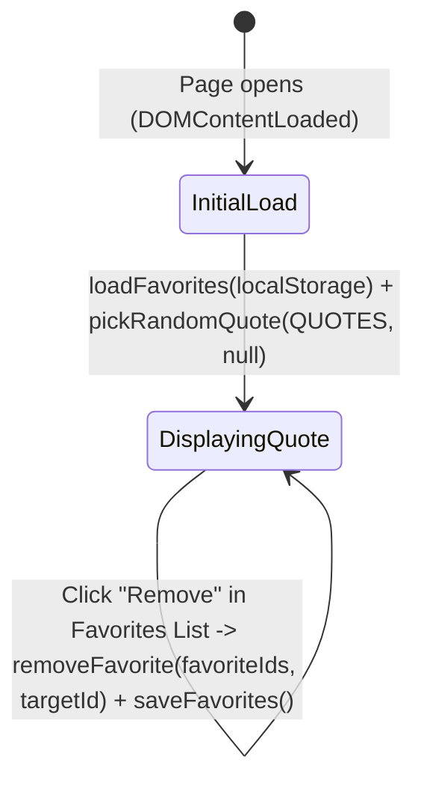

# Data Model: Quote of the Day

**Feature**: `001-quote-of-the-day`
**Date**: 2026-10-17

## Entities

### 1. `Quote`

Represents an immutable quotation entry in the built-in collection `QUOTES`.

| Field | Type | Constraints | Description |
|-------|------|-------------|-------------|
| `id` | `string` | Required, unique, non-empty, pattern `^q-\d{2,}$` | Stable identifier used for favorite tracking and deduplication |
| `text` | `string` | Required, non-empty, max length 300 chars | The quotation body text (without surrounding quotation marks) |
| `author` | `string` | Required, non-empty, max length 100 chars | Attributed author name |

**Validation Rules**:
- Collection `QUOTES` MUST contain at least 8 distinct `Quote` objects (FR-001).
- Every `Quote.id` MUST be unique across `QUOTES`.

---

### 2. `FavoriteState`

Represents the user's saved favorite quotes, persisted in `localStorage` under key `STORAGE_KEY = "qotd_favorites_v1"`.

| Field | Type | Constraints | Description |
|-------|------|-------------|-------------|
| `favoriteIds` | `string[]` | Ordered array of unique `Quote.id` strings present in `QUOTES` | List of favorited quote identifiers in the order they were favorited |

**Validation & Sanitization Rules**:
- When deserializing from raw JSON string:
  1. If input is `null`, `undefined`, empty string, or invalid JSON → return `[]`.
  2. If parsed JSON is not an `Array` (e.g., object, number, boolean, string) → return `[]`.
  3. Filter elements: keep only values where `typeof id === "string"`, `id` exists in `QUOTES` (`validIds.has(id)`), and `id` has not already appeared earlier in the array (deduplication preserving insertion order).

---

## State Transitions

1. **Initial Load (`initApp`)**:
   - Load `favoriteIds` via `loadFavorites(storage, QUOTES)`.
   - Pick initial `currentQuote` via `pickRandomQuote(QUOTES, null)`.
   - Render main quote card, favorite toggle state (`isFavorite(favoriteIds, currentQuote.id)`), and favorites list.
2. **Cycle Quote (`New quote` click)**:
   - Update `currentQuote = pickRandomQuote(QUOTES, currentQuote.id)`.
   - Re-render main quote card and update favorite toggle state (`aria-pressed`, icon, label) to match `isFavorite(favoriteIds, currentQuote.id)`.
3. **Toggle Current Quote Favorite (`Favorite` button click)**:
   - Update `favoriteIds = toggleFavorite(favoriteIds, currentQuote.id)`.
   - Persist `saveFavorites(storage, favoriteIds)`.
   - Re-render favorite toggle button and favorites list section.
4. **Remove Favorite from List (`Remove` button click on item `id`)**:
   - Update `favoriteIds = toggleFavorite(favoriteIds, id)` (or `removeFavorite(favoriteIds, id)`).
   - Persist `saveFavorites(storage, favoriteIds)`.
   - Re-render favorites list section and, if `currentQuote.id === id`, update the main favorite toggle button to `aria-pressed="false"`.
